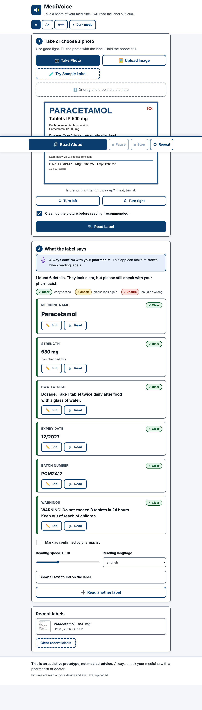
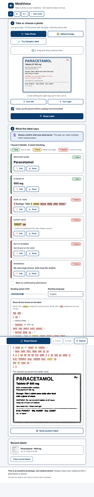
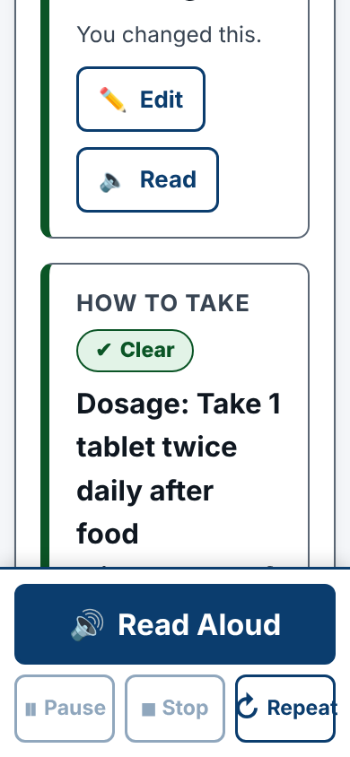
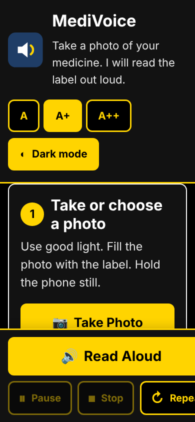

# MediVoice – Assistive Medication Label Reader

> Take a photo of your medicine. MediVoice reads the label out loud.

MediVoice is a free web app that runs entirely in the browser. It uses OCR (optical character recognition) and text-to-speech to read medicine packs and prescription labels aloud. It finds the **medicine name, strength, instructions, expiry date, batch number and warnings**, marks any reading it is not sure about, and always asks the user to **confirm the details with a pharmacist**.

**This is an assistive prototype, not medical advice.**

---

## The problem

Older adults and people with low vision often cannot read the tiny print on medicine strips, bottles and pharmacy labels. Misreading a strength ("5 mg" vs "50 mg") or missing an expiry date can cause real harm. Magnifiers help, but many people still need someone else to read the label for them.

MediVoice aims to give back some independence. It reads the label aloud in plain language. It is honest when it is unsure ("I am not sure about the strength. It may be 500 milligrams. Please check."). It always sends the user to a pharmacist as the final check.

## Features

| Area | What it does |
|---|---|
| **Image input** | **Take Photo** opens the rear camera on phones. **Upload Image**, **drag-and-drop** and **paste (Ctrl+V)** work on laptops. A preview is shown before reading. |
| **Image clean-up** | Uses canvas. Small images are upscaled to about 2000 px wide, then converted to grayscale, contrast-stretched and **adaptively thresholded** so shadows and glare don't wipe out text. Light-on-dark labels are inverted automatically. **Turn left / Turn right** buttons rotate the picture in 90° steps. |
| **OCR** | Tesseract.js v5 runs in the browser with a **progress bar and percentage**. Word-level and line-level confidence is kept. If the cleaned-up picture reads poorly, MediVoice retries once with the original picture and keeps the better result. |
| **Field extraction** | Rule-based. **Name:** fuzzy match (Levenshtein) against 240+ common Indian and generic medicines. It handles OCR look-alikes such as `0→O` and `1→I`, and two-word brands such as "Dolo 650". If nothing matches, it falls back to the largest line of text and marks it "Unsure". **Strength:** numbers with units (mg, mcg, g, ml, IU, %), including `125 mg/5 ml` and combinations. **Instructions**, **expiry** (with an "already expired" check), **batch number** and **warnings** are found by keyword rules. |
| **Confidence** | Words below 70% confidence are highlighted **yellow with a dotted underline**. Words below 50% are highlighted **red**. Each field gets a **Clear** (green), **Check** (amber) or **Unsure** (red) badge. |
| **Editing** | Every field can be edited, by the user or a helper. A corrected field is treated as clear. |
| **Text-to-speech** | A big **Read Aloud** button. **Play / Pause / Stop / Repeat** controls, a **speed slider (0.6×–1.5×)**, and **English, Hindi or Telugu** speech. It says what the medicine is usually used for ("usually used for pain and fever"), with a reminder that the doctor may have had another reason. Units are read in full ("mg" becomes "milligrams"), and so are common prescription short forms (BD, TDS, OD, SOS, "1-0-1"). Unclear fields are read as a question. Every reading ends with *"Please confirm these details with your pharmacist before taking this medicine."* Each card also has its own **Read** button. |
| **Pharmacist check** | A banner on every result says "Always confirm with your pharmacist". There is also a **Mark as confirmed by pharmacist** checkbox, which is saved with the scan. |
| **Extras** | **Try Sample Label** draws a demo label on a canvas and runs the full flow. The full raw OCR text (with highlighting) and the cleaned-up image are in a collapsible section. **Recent labels** are saved in `localStorage`, on this device only. |
| **Errors** | If no text is found, the app shows and speaks: *"I could not read the label. Try more light, hold the camera steady, and fill the frame with the label."* Browsers without speech support get a clear notice. If no Hindi or Telugu voice is installed, the app says so. |

### Accessibility

- Base text is 20 px and buttons are at least 56 px tall. The **A / A+ / A++** text size toggle and the **high-contrast dark mode** are remembered between visits.
- Colour pairs meet WCAG AA (most meet AAA). Badges use an icon and a word as well as colour.
- Full keyboard use. There is a skip link and a thick, two-colour focus ring that shows on any background. `aria-label`s contain the visible button text. `Esc` stops speech or closes an edit box.
- An `aria-live` region announces progress ("Reading label… 60%"), results and actions. Unclear words also carry a screen-reader-only "(unclear)" hint.
- The layout is responsive, with one column on phones. On phones a sticky bottom bar holds the big Read Aloud button. Reduced-motion and Windows high-contrast (forced colours) settings are respected.
- The wording is simple throughout: "How to take", "Check", "Unsure".

## Tech stack

- **HTML, CSS and vanilla JavaScript** (ES modules). No framework, no build step.
- **[Tesseract.js v5](https://github.com/naptha/tesseract.js)** (5.1.1, from the jsDelivr CDN) for in-browser OCR. No API key is needed.
- **Web Speech API** (`speechSynthesis`) for text-to-speech.
- **Canvas 2D** for image pre-processing and the sample label.
- **localStorage** for history and settings.
- **Node's built-in test runner** for unit tests. No dependencies.

There is no backend, no login and no paid API. Pictures never leave the device.

## Project structure

```
medivoice/
├── index.html          # Page layout: steps 1–3, history, sticky speech bar
├── css/
│   └── styles.css      # Themes, text sizes, layout, highlighting
├── js/
│   ├── app.js          # Main controller: wires UI, OCR, extraction, speech, history
│   ├── preprocess.js   # Canvas: rotate, upscale, grayscale, contrast, adaptive threshold
│   ├── ocr.js          # Tesseract.js worker, progress, result normalisation
│   ├── extract.js      # Rule-based field extraction + confidence badges (no DOM)
│   ├── medicines.js    # Built-in list of 240+ medicine names
│   ├── narration.js    # Builds the spoken script (English, Hindi, Telugu), unit expansion
│   ├── uses.js         # "Usually used for" descriptions in English, Hindi and Telugu
│   ├── speech.js       # speechSynthesis wrapper: play/pause/stop/repeat, voices
│   ├── sample.js       # Draws the demo label on a canvas
│   └── history.js      # localStorage history + settings (safe if storage is blocked)
├── tests/
│   └── extract.test.js # Unit tests for extraction and narration
├── docs/screenshots/   # Screenshots used below
├── vercel.json         # Optional Vercel headers
├── netlify.toml        # Optional Netlify config
└── package.json        # Only for `npm start` / `npm test` (no dependencies)
```

## Run locally

The app uses ES modules, so it must be served over `http://` (opening `index.html` directly as a `file://` will not work).

```bash
cd medivoice

# Option 1: Node
npm start                 # serves on http://localhost:5173

# Option 2: Python
python3 -m http.server 5173

# Run the unit tests (Node 18+)
npm test
```

Open <http://localhost:5173> and press **Try Sample Label**. The first scan downloads the OCR engine and English language data (about 10 MB). Later scans use the browser cache.

> **Camera on phones:** browsers only allow the camera on `https://` or `localhost`. To test on a phone, deploy it (below) or use a tunnel such as `npx localtunnel --port 5173`.

## Deploy on Vercel (free)

1. Push this repository to GitHub.
2. Go to <https://vercel.com/new> and import the repository.
3. Under **Root Directory**, choose **`medivoice`**.
4. Set **Framework Preset** to **Other**. Leave the **Build Command** empty and set the **Output Directory** to `.` (the default).
5. Click **Deploy**. You get an `https://…vercel.app` URL, and the camera works there.

Or use the CLI:

```bash
npm i -g vercel
cd medivoice
vercel --prod
```

### Other free hosts

- **Netlify:** "Add new site" → import from Git → **Base directory** `medivoice`, no build command, publish directory `medivoice`. You can also drag the `medivoice` folder onto <https://app.netlify.com/drop>.
- **GitHub Pages:** copy the contents of `medivoice/` to a `gh-pages` branch, or to `/docs` on the main branch, then enable Pages in the repository settings. The `.nojekyll` file is already included.

## Screenshots

| Desktop result | Unclear photo: low-confidence highlighting |
|---|---|
|  |  |

| Phone, extra-large text | Phone, high-contrast dark mode |
|---|---|
|  |  |

## How it works

1. **Pre-process** (`preprocess.js`): rotate, then resize to about 2000 px wide, then convert to grayscale. Next comes a 2–98 percentile contrast stretch. If most pixels are dark, the image is inverted. Finally a Bradley adaptive threshold (using an integral image) is applied, with Otsu as the fallback for flat areas.
2. **OCR** (`ocr.js`): a single reused Tesseract worker. Results are normalised into `lines → words`, each with a confidence score.
3. **Extract** (`extract.js`):
   - *Name*: every word and every adjacent pair of words is compared with the medicine list using Levenshtein similarity. A similarity of at least 0.75–0.8 counts as a match. Names of 4 letters or fewer must match exactly. Spelling closeness, OCR confidence and text height are combined into a score. The confidence shown is OCR confidence × similarity.
   - *Badge*: an average of 80 or more is **Clear**, 60–79 is **Check**, and below 60 is **Unsure**. A single word under 50% also downgrades Clear to Check.
4. **Narrate** (`narration.js`): short sentences with units and short forms expanded. Unclear fields use "I am not sure about…". The pharmacist reminder always comes last.
5. **Speak** (`speech.js`): sentences are queued one by one, which avoids Chrome's cut-off for long speech and allows pause and resume.

## Limitations

- OCR on curved bottles, shiny foil strips and very small print is hard. The app says when it is unsure, but it can still be wrong when it seems sure. That is why the pharmacist check is always required.
- Field extraction uses rules, not a medicine database. It does not check doses, interactions or whether a medicine is right for you.
- Hindi and Telugu speech need a matching voice on the device. Android and Windows usually have one. On iOS, add one under Settings → Accessibility → Spoken Content → Voices.

## Future scope

- **Hindi and Telugu OCR:** load the `hin` and `tel` Tesseract language data so labels printed in Indian languages can be read.
- **Barcode and QR scan:** read the pack barcode or QR code (e.g. with the `BarcodeDetector` API or ZXing) to identify the exact product.
- **Medicine database API:** check names and strengths against an open drug database (e.g. CDSCO data, openFDA or RxNorm) and show plain-language uses and side effects.
- **Reminders:** turn "1-0-1, after food" into dose reminders with notifications. Make the app an installable offline PWA.
- **Live camera mode:** guide the user to hold the camera steady ("move closer", "more light") before taking the picture.
- **Share with a carer:** send the confirmed details to a family member or pharmacist.

## Disclaimer

MediVoice is an assistive prototype for educational purposes. **It is not medical advice and is not a medical device.** Always confirm medicine details with a pharmacist or doctor before taking any medicine.
